# Supabase i Samrådsguiden: så är rangordningen kopplad till en databas

*Arbetsdokument 2026-10-20. Beskriver vad som görs för att skapa och använda en Supabase-databas för den gemensamma rangordningen av frågorna i Tabell 6 ([maxima.html](https://kentlundgren.github.io/Codex/Fritid/NF/Samradsguiden/maxima.html#tabell-6)). Jämförs med motsvarande beskrivning för Firebase: [databas.html, Bjerreds Saltsjöbad](https://kentlundgren.github.io/foreningar/BjerredsSaltsjobad/inpasseringar/databas.html). Uppgifter om Supabase är hämtade ur Supabases dokumentation och min egen kännedom och är inte kvalitetssäkrade. Kontrollera mot [supabase.com/docs](https://supabase.com/docs) innan något beslut bygger på dem, särskilt gränser och priser.*

- **Prototypen:** [rangordning.html](https://kentlundgren.github.io/Codex/Fritid/NF/Samradsguiden/Maxima/rangordning.html)
- **Tabeller och funktioner (SQL):** [supabase_setup.sql](https://github.com/kentlundgren/Codex/blob/main/Fritid/NF/Samradsguiden/supabase_setup.sql)
- **Allmänt om rangordningar:** [rangordning/](https://kentlundgren.github.io/Codex/Fritid/NF/Samradsguiden/rangordning/)
- **Sidans kod:** `rangordning/rangordning.js`, `rangordning/rangordning.css`, `rangordning/rangordning_config.js` (gemensam kod för alla rangordningar)
- **Filstruktur:** omröstningen om MAXIMA ligger i `Maxima/`, det allmänna navet och den gemensamma koden i `rangordning/`. Prototypen låg först direkt i `Samradsguiden/`. Den gamla adressen finns kvar som en ersättningssida som skickar vidare.
- **Korsreferens:** se [Jämförelse med Firebase](#jamforelse) och [Korsreferens åt andra hållet](#korsreferens)

---

## 0. Status och ändringslogg <a id="status"></a>

**Status 2026-10-20 (kväll):** Supabase-projektet är skapat, SQL-skriptet är körts, och den publicerade sidan är ansluten till databasen. Vi har alltså passerat demoläget (se Bild 9 och Bild 11). Funktionen för att nollställa röster är installerad, och adminkoden sätts av Kent (steg 7).

| Datum | Vad som hände |
|---|---|
| 2026-10-20 | Konto, organisation och projekt skapade (steg 1, bild 1–5). |
| 2026-10-20 | SQL-skriptet körts, nyckeln hämtad och inlagd (steg 2–4, bild 6–8). Provat mot det riktiga projektet (steg 5). |
| 2026-10-20 | Demoläget visades en stund på den publicerade sidan på grund av en äldre kopia i webbläsaren (Bild 9). Efter omladdning visades den riktiga databasen (Bild 11). |
| 2026-10-20 | Funktionen `nollstall_roster` och kolumnen `admin_kod_hash` lades till (steg 7, bild 10). Provad med fel kod: svarar "Fel kod" efter ungefär två sekunder. |
| 2026-10-20 | **Filerna flyttades.** Omröstningen om MAXIMA ligger nu på `Samradsguiden/Maxima/rangordning_prototyp.html`, och gemensam kod och en allmän sida om rangordningar ligger i `Samradsguiden/rangordning/`. Den gamla adressen (`Samradsguiden/rangordning_prototyp.html`) är en ersättningssida som skickar vidare. Databasen påverkades inte av flytten. |
| 2026-10-20 | **Sidan döptes om** från `Maxima/rangordning_prototyp.html` till `Maxima/rangordning.html`, eftersom ordet "prototyp" inte hör hemma i en adress som används på riktigt. Den tidigare adressen är nu en ersättningssida som skickar vidare, och det gäller även den allra första (`Samradsguiden/rangordning_prototyp.html`). Röster och användarnas identitet påverkades inte, eftersom webbläsaren sparar nyckeln per webbplats och inte per sida. |
| 2026-10-20 | Menyvalet *Rangordningar* lades till i huvudmenyn på alla sidor, och en ruta på `maxima.html` (#skede5-rangordning) länkar till omröstningen. |

---


## 1. Vad som byggs <a id="vad"></a>

En tabell (Tabell 6) med 13 frågor ska kunna ordnas om av läsarna. Varje läsare gör sin egen rangordning, och sidan räknar ut **gruppens rangordning** som medelplats: för varje fråga läggs alla röstade platser ihop och delas med antalet röster. Resultatet visas direkt, utan att sidan laddas om, och nästa besökare ser samma gruppordning.

Kraven från Kent:

| Krav | Hur det löses |
|---|---|
| Ingen inloggning | Webbläsaren får en slumpad nyckel (token). Den fungerar som lösenord för den egna rösten. |
| Namn är frivilligt, anonyma ska kunna ändra | Namnfältet får vara tomt. Rösten räknas lika mycket. |
| Ändringen syns direkt | Sidan räknar om gruppens ordning i webbläsaren i samma ögonblick som en rad flyttas, och sparar i databasen en kort stund senare. |
| Öppen sida | Ingen kod eller inloggning krävs. Skyddet ligger i databasens regler (steg 2) och i att sidan inte är länkad från menyn. |
| Gruppens ordning, inte sista som sparade | Varje webbläsare har en egen rad i databasen. Sidan tar medelplatsen över alla rader. |

## 2. Förklaring av orden <a id="ord"></a>

- **Databas.** En plats i molnet där data sparas så att alla besökare ser samma sak. En webbsida på GitHub Pages kan inte spara något själv.
- **Statisk och dynamisk.** Ordet används om två olika saker. *Statisk hosting* betyder att filerna (HTML, CSS, JavaScript) ligger oförändrade på servern, som på GitHub Pages. En *dynamisk sida* betyder att det besökaren ser ändras, till exempel när någon röstar. De två går ihop: rangordningen är en dynamisk sida, eftersom innehållet kommer från databasen, men den ligger på statisk hosting, eftersom det är webbläsaren som hämtar och visar rösterna. Ingen egen server behövs. En sida som saknar databas kan också vara dynamisk, till exempel med JavaScript som räknar om något, men den glömmer allt när den laddas om.
- **Supabase.** En tjänst som ger en databas av typen PostgreSQL, med ett färdigt API (ett sätt för webbsidan att prata med databasen över internet).
- **SQL.** Språket som beskriver tabeller och regler i en databas. I det här projektet är det en enda fil som körs en gång.
- **Tabell (i databasen).** Rader och kolumner, som ett kalkylark.
- **Row Level Security (RLS).** Databasregler som bestämmer vilka rader en besökare får läsa och ändra. Utan regler är tabellen låst. [Supabases beskrivning](https://supabase.com/docs/guides/database/postgres/row-level-security).
- **Funktion (RPC).** En liten ordnad åtgärd i databasen som sidan får anropa, till exempel "spara min röst". Sidan får inte röra tabellen direkt. [Supabases beskrivning](https://supabase.com/docs/guides/database/functions).
- **Publik nyckel (anon eller publishable).** En nyckel som är gjord för att ligga i webbsidor. Den ger bara åtkomst till det som reglerna tillåter. Den hemliga nyckeln (service_role eller secret) ger full åtkomst och ska **aldrig** ligga på en webbsida. [Supabases beskrivning](https://supabase.com/docs/guides/api/api-keys).

## 3. Steg för steg <a id="steg"></a>

### Steg 1. Skapa konto, organisation och projekt (Kent gör)

*Den här delen uppdateras under tiden, i takt med att stegen genomförs. Bilderna ligger i [Maxima/Supabase/Bilder](https://github.com/kentlundgren/Codex/tree/main/Fritid/NF/Maxima/Supabase/Bilder). Supabase ändrar ibland sina menyer, så knappnamnen kan skilja sig från de här.*

**1a. Gå till supabase.com och starta.** Öppna [supabase.com](https://supabase.com) och klicka på den gröna knappen **Start your project**. (Bilden är tagen efter inloggning, då det står **Dashboard** uppe till höger i stället.)

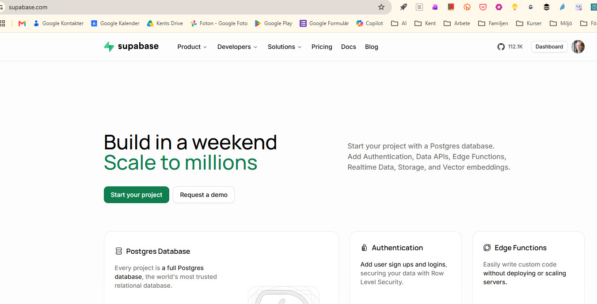

*Bild 1. Supabases startsida. Källa: skärmdump, 2026-10-20.*

**1b. Logga in via GitHub.** På inloggningssidan valdes **Continue with GitHub**, eftersom Kent redan har ett GitHub-konto. Då behövs inget nytt lösenord till Supabase, och inloggningen sker med GitHub-kontot. Godkänn att Supabase får läsa kontots grundläggande uppgifter när GitHub frågar. (E-post och lösenord fungerar också.)

**1c. Skapa en organisation.** Efter inloggningen visas sidan **Your organizations** (adressen slutar på `/dashboard/organizations?method=github`). En **organisation** är bara en mapp där projekten ligger. Klicka på **New organization**.

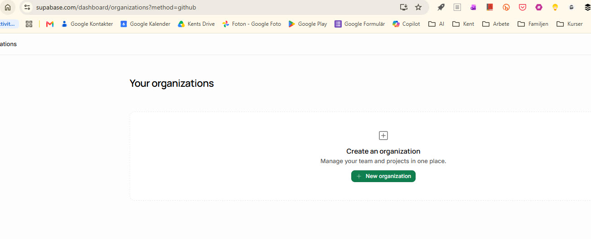

*Bild 2. Första sidan efter inloggning med GitHub. Källa: skärmdump, 2026-10-20.*

**1d. Fyll i organisationen.** Efter klicket på **New organization** visas formuläret *Create a new organization*. Kent valde:

| Fält | Val | Förklaring |
|---|---|---|
| **Name** | `Samradsguiden` | Namnet på mappen som projekten ligger i. Går att ändra senare. |
| **Type** | `Personal` | Ett personligt konto, inte ett företag eller en grupp. |
| **Plan** | `Free - $0/month` | Gratisplanen. Inget betalkort behövs. |

Klicka sedan på **Create organization** (grön knapp nere till höger).

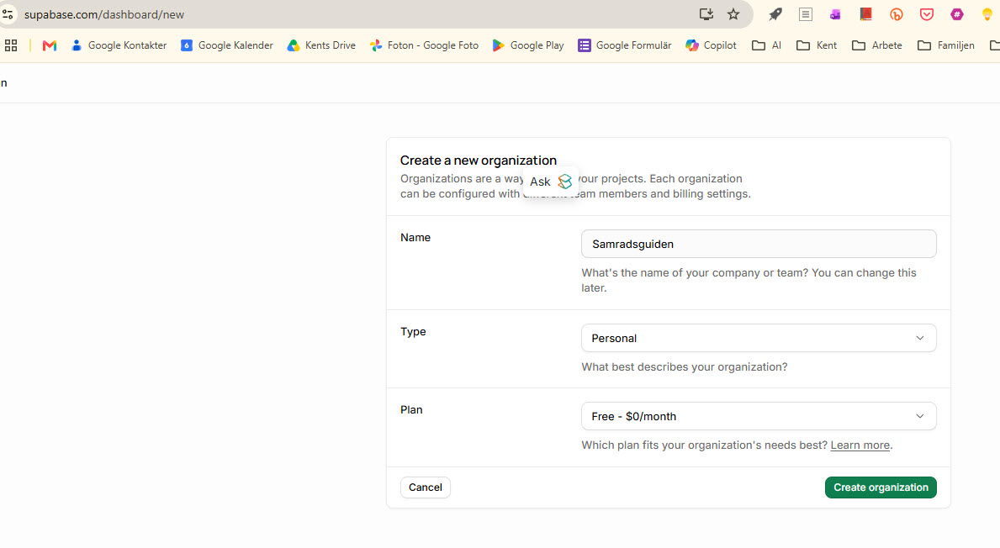

*Bild 3. Formuläret för en ny organisation, ifyllt. Källa: skärmdump, 2026-10-20.*

**1e. Fyll i projektet.** Efter *Create organization* visas formuläret *Create a new project*. Valen, med skälen:

| Fält | Val | Förklaring |
|---|---|---|
| **Organization** | `Samradsguiden` (Free) | Förifyllt. Det är organisationen från steg 1d. |
| **GitHub (optional)** | Hoppa över | Gör att databasens uppsättning kan följa kod i GitHub. Behövs inte, eftersom hela uppsättningen är en SQL-fil som körs en gång. |
| **Project name** | `samradsguiden` | Förslaget var *kentlundgren's Project*. Ändras till ett namn som säger vad projektet är. |
| **Database password** | Klicka **Generate a password** och spara det i en lösenordshanterare | Lösenordet till själva databasen. Sidan använder det inte, och det delas inte med någon. Det visas ofta bara en gång. |
| **Region** | `Europe` | Datan ligger då i Europa. |
| **Enable Data API** | Ikryssad (behåll) | Gör att sidan kan prata med databasen över internet. Utan den fungerar inte rangordningen. |
| **Automatically expose new tables** | **Ta bort kryssen** | Supabase rekommenderar det själva. Nya tabeller blir då inte öppna av sig själva. Rangordningens tabeller är låsta på avsikt, och SQL-filen öppnar bara de fyra funktionerna. |
| **Enable automatic RLS** | **Kryssa i** | Gör att Row Level Security slås på för alla nya tabeller. SQL-filen gör det redan, så detta är en extra säkerhet. |
| **Advanced configuration** | Lämna orört | Behövs inte. |

Klicka sedan på **Create new project** (grön knapp nere till höger) och vänta ett par minuter tills projektet är klart.

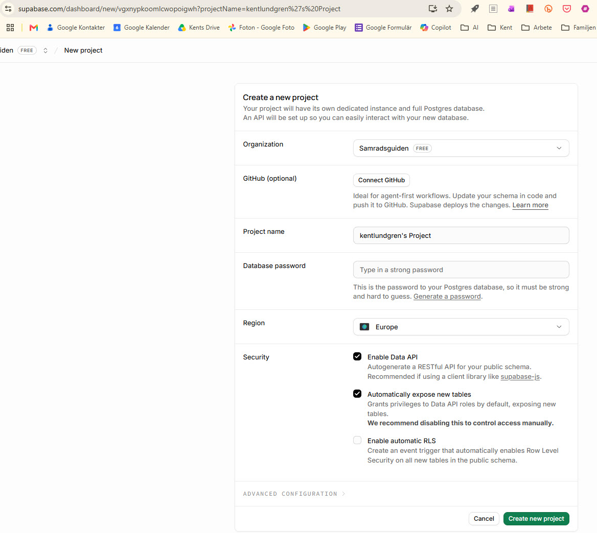

*Bild 4. Formuläret för ett nytt projekt, med Supabases förslag innan några ändringar. Källa: skärmdump, 2026-10-20.*

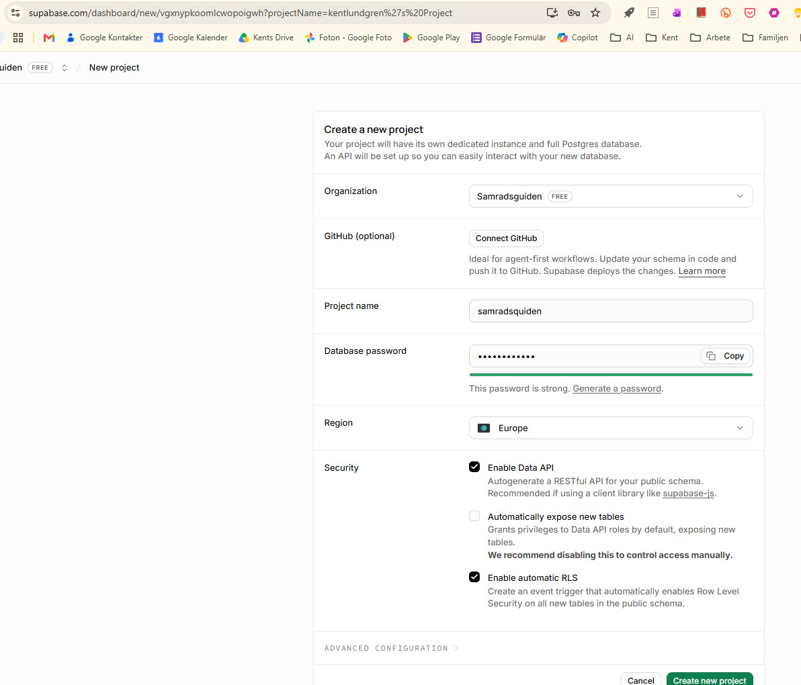

*Bild 4B. Samma formulär efter ändringarna: lösenord genererat, "Automatically expose new tables" urkryssad och "Enable automatic RLS" ikryssad. Källa: skärmdump, 2026-10-20.*

*Notering:* i projektnamnet blev det `samradsquiden` (med q) i stället för `samradsguiden`. Namnet är bara en etikett i Supabase och påverkar inte adressen eller sidan. Det går att ändra under **Project Settings, General**.

**1f. Projektet är klart.** Efter *Create new project* öppnas projektets översikt. När det står **Status: Healthy** är databasen igång. Projektets adress (**Project URL**) står under projektnamnet: `https://basgvwqqdbkwadfjzaxc.supabase.co`. Adressen är inte hemlig. Den är gjord för att ligga på webbsidor och skyddas av databasens regler. Projektet ligger i regionen *West EU (Ireland)* på gratisplanen (compute size *Nano*).

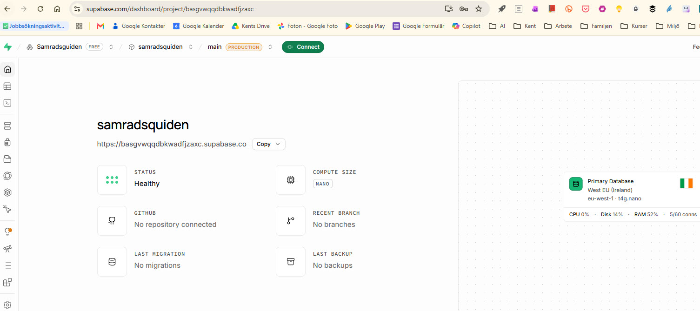

*Bild 5. Projektets översikt direkt efter att det skapats. Källa: skärmdump, 2026-10-20.*

### Steg 2. Skapa tabeller och regler (en gång)

1. I projektet: **SQL Editor**, sedan **New query**.
2. Öppna [supabase_setup.sql](https://github.com/kentlundgren/Codex/blob/main/Fritid/NF/Samradsguiden/supabase_setup.sql), kopiera hela filen, klistra in och tryck **Run**.
3. Under **Table Editor** ska två tabeller finnas: `rangordning_roster` (rösterna) och `rangordning_installning` (sista dag och stängning).

Så såg det ut när det genomfördes:

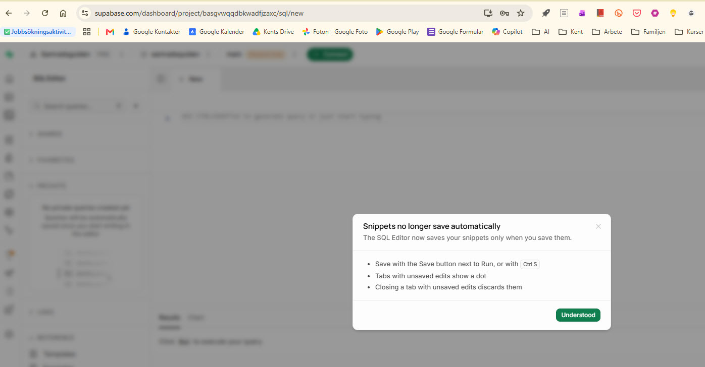

*Bild 7. Första gången SQL Editor öppnas visas ett meddelande om att frågor inte längre sparas automatiskt. Klicka **Understood**. Skriptet behöver inte sparas, eftersom det finns i filen `supabase_setup.sql`. Källa: skärmdump, 2026-10-20.*

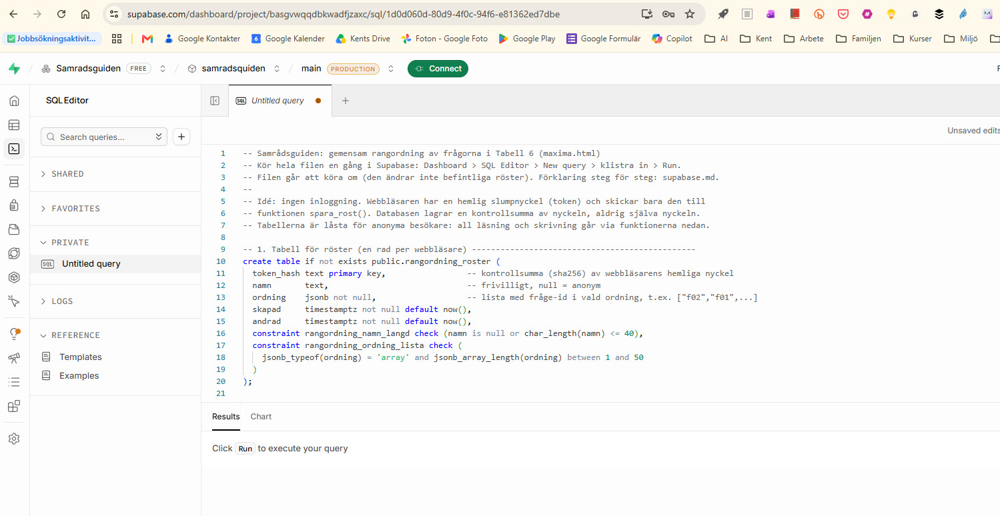

*Bild 8. Skriptet inklistrat i SQL Editor, före Run. Bara början syns, men hela filen ligger i fönstret. Källa: skärmdump, 2026-10-20.*

Vad filen gör:

| Del | Innehåll | Varför |
|---|---|---|
| Tabellen `rangordning_roster` | En rad per webbläsare: kontrollsumma av nyckeln, frivilligt namn, ordningen som en lista (`["f02","f01",…]`), tider | Här sparas rösterna. Namnet får vara högst 40 tecken. |
| Tabellen `rangordning_installning` | En rad med sista dag (2026-11-06 23:59:59, svensk tid) och en brytare för att stänga | Röstningen kan frysas utan att sidan ändras. |
| RLS på och inga öppna regler | Anonyma besökare får inte läsa eller skriva i tabellerna direkt | Utan det kan vem som helst, med den publika nyckeln, ändra allt. |
| `hamta_roster()` | Ger alla röster utan nycklar | Sidan kan räkna ut gruppens ordning. |
| `hamta_status()` | Ger sista dag, om det är stängt och antal röster | Sidan kan visa "röstningen är stängd". |
| `spara_rost(token, namn, ordning)` | Kontrollerar indata, sparar eller ersätter rösten | Kontrollen sker i databasen, inte i webbläsaren. Bara kända fråge-id, inga dubbletter, rensat namn och en gräns på 500 röster mot översvämning. |
| `radera_min_rost(token)` | Raderar den egna raden | Den som har skrivit sitt namn kan ta bort det igen. |
| `nollstall_roster(kod)` | Raderar alla röster, men bara med rätt adminkod (kontrollsumman ligger i inställningstabellen) | Gör att du kan nollställa från sidan utan att vem som helst kan göra det. Se steg 7. |
| `revoke` och `grant` | Bara de fem funktionerna får anropas av anonyma | Allt annat är stängt. |

**Varför funktioner i stället för att låta sidan skriva i tabellen?** Rösternas rader är offentliga i den meningen att alla ser gruppens ordning. Hade sidan fått läsa tabellen direkt hade den också fått läsa nycklarna, och då hade vem som helst kunnat ändra någon annans röst. Nu lagras bara en kontrollsumma av nyckeln, och bara den som har nyckeln kan uppdatera sin rad.

### Steg 3. Kontrollera att det fungerar (valfritt, men bra)

Ersätt `PROJEKT` och `NYCKEL` med dina värden. Första kommandot ska svara med sista dag, `false` och `0` (eller antalet röster).

```bash
curl -s -X POST "https://PROJEKT.supabase.co/rest/v1/rpc/hamta_status" -H "apikey: NYCKEL" -H "Content-Type: application/json" -d "{}"
```

### Steg 4. Koppla sidan till projektet (Kent skickar värden, Claude fyller i)

1. Klicka på den gröna knappen **Connect** högst upp i projektet. En panel, *Connect to your project*, öppnas (Bild 6). Den är gjord för utvecklare som använder ramverk som Next.js. Vi använder inget av det, men panelen visar projektets adress och den publika nyckeln.

   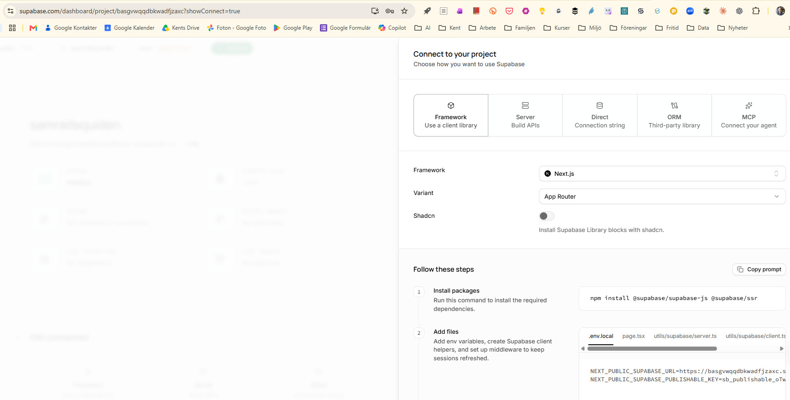

   *Bild 6. Panelen Connect. Under "Add files", fliken `.env.local`, står projektadressen (`NEXT_PUBLIC_SUPABASE_URL`) och den publika nyckeln (`NEXT_PUBLIC_SUPABASE_PUBLISHABLE_KEY`). Källa: skärmdump, 2026-10-20.*

2. Den **publika nyckeln** (publishable key) börjar med `sb_publishable_`. Kopiera bara texten efter likhetstecknet. Alternativt: **Project Settings** (kugghjulet), **API Keys**.
3. **Project URL** är redan känd: `https://basgvwqqdbkwadfjzaxc.supabase.co` (steg 1f).
4. Skicka den publika nyckeln, eller klistra in den själv i `rangordning/rangordning_config.js` (fältet `anonKey`). **Skicka inte** den hemliga nyckeln (`service_role` eller `secret`).
5. Är något av fälten tomma kör sidan i **demoläge** med påhittade röster, sparade i den egna webbläsaren.

### Steg 5. Testa

**Provat 2026-10-20** (med publika nyckeln, via `curl` mot projektets API):

| Prov | Förväntat | Resultat |
|---|---|---|
| `spara_rost` med giltig ordning och namnet "  Testperson  " | Sparas, namnet rensas från blanksteg | Sparades som "Testperson" |
| `hamta_roster` och `hamta_status` | Visar rösten, antal 1 | Rätt |
| Ordning med dubbletter | Nekas | Nekades ("Dubbletter i ordningen") |
| Ordning med ogiltigt id (`<script>`) | Nekas | Nekades ("Ogiltigt fråge-id") |
| Läsa tabellen `rangordning_roster` direkt | Nekas | Nekades (HTTP 401) |
| Skriva i tabellen direkt | Nekas | Nekades (HTTP 401) |
| Ändra `stangd` i inställningstabellen direkt | Nekas | Nekades (HTTP 401) |
| `radera_min_rost` | Raden försvinner | Raderades, listan tom |
| Sidan i webbläsare: flytta en rad | Röst sparas, gruppens ordning och Tabell 6 räknas om | Sparades, status "Sparat", gruppens ordning ändrades |
| Sidans knapp "Ta bort min röst" | Rösten raderas | Raderades, databasen tom efteråt |

Teströsterna är raderade, så databasen är tom inför start.

**Om du ser "Demoläge" och några röster som inte stämmer.** Efter att konfigurationen pushats visade den publicerade sidan en stund fortfarande *Demoläge: ingen databas är ansluten* och "Medel av 4 röster" (Bild 9). De fyra rösterna var tre påhittade demoröster plus en provröst i den egna webbläsaren, inte riktiga röster. Demoläget slås på när adress eller nyckel saknas, och det hände här eftersom webbläsaren visade en äldre kopia av `rangordning_config.js`. Lösning: ladda om med Ctrl+F5. Om det består, kontrollera att filen på Pages innehåller adressen och nyckeln: `https://kentlundgren.github.io/Codex/Fritid/NF/Samradsguiden/rangordning/rangordning_config.js`.

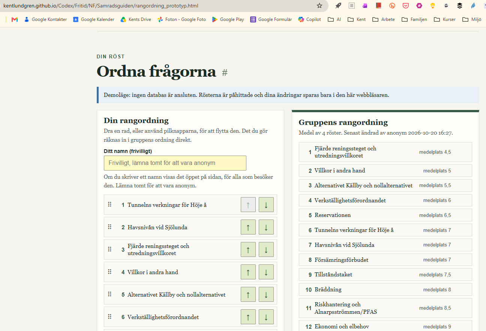

*Bild 9. Prototypen i demoläge på den publicerade sidan, före omladdning. Källa: skärmdump, 2026-10-20.*

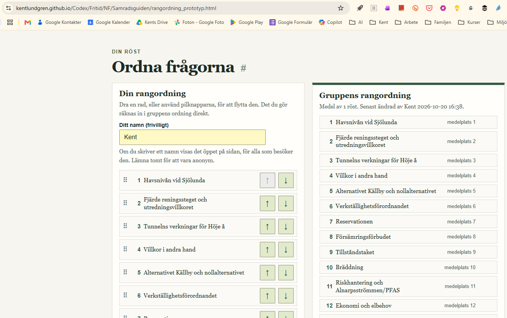

*Bild 11. Den publicerade prototypen efter att den kopplats till databasen, på den gamla adressen innan filerna flyttades. Ingen demobanner visas, namnet "Kent" syns på den egna rösten, och gruppens ordning bygger på en riktig röst ("Medel av 1 röst. Senast ändrad av Kent"). Källa: skärmdump, 2026-10-20.*

**Så testar du själv:**

1. Öppna prototypen, flytta en rad och kontrollera att **Gruppens rang** och Tabell 6 ändras direkt.
2. Öppna sidan i ett annat webbläsarfönster eller en privat flik. Du ska se rösten från det första fönstret efter högst 15 sekunder (sidan hämtar om rösterna med den tiden).
3. I Supabase, **Table Editor**, `rangordning_roster`, ska raderna synas. (Tabellen är låst för besökare men du ser den som ägare.)

### Steg 6. Drift, stängning och städning

SQL-kommandon, i SQL Editor (finns också längst ned i SQL-filen):

```sql
update public.rangordning_installning set stangd = true  where id = 1;   -- stäng röstningen nu
update public.rangordning_installning set stangd = false where id = 1;   -- öppna igen
update public.rangordning_installning set frist = '2026-11-07 12:00+01' where id = 1;  -- flytta sista dag
select namn, ordning, andrad from public.rangordning_roster order by andrad desc;     -- se alla röster
delete from public.rangordning_roster where namn = 'Namn att ta bort';   -- ta bort en röst
truncate public.rangordning_roster;                                       -- töm alla röster
```

Efter sista dag stänger databasen skrivning av sig själv (funktionen `spara_rost` kontrollerar sista dag). Sidan visar då den slutliga ordningen.

### Steg 7. Nollställa alla röster från sidan (administratör)

Under gruppens rangordning finns en nästan osynlig länk, **nollställ**, i ljusgrått och med liten text. Den raderar alla röster för alla besökare. Av det skälet kräver den en **adminkod** som bara du känner till. Koden kontrolleras i databasen och står inte i sidans kod.

**Status 2026-10-20:** funktionen och kolumnen är installerade (kördes i SQL Editor, Bild 10), och funktionen är provad med fel kod. Utan satt kod svarar den alltid "Fel kod", så ingen kan nollställa av misstag. Adminkoden sätts av Kent i punkt 3 nedan.

1. **Kör SQL-filen en gång till** (den går att köra om): [supabase_setup.sql](https://github.com/kentlundgren/Codex/blob/main/Fritid/NF/Samradsguiden/supabase_setup.sql). Då läggs funktionen `nollstall_roster` och en kolumn för kodens kontrollsumma till.

   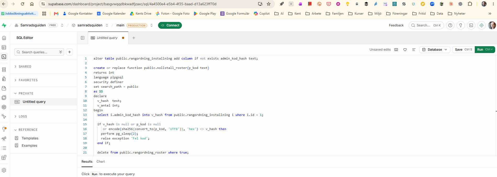

   *Bild 10. SQL Editor med den nya delen inklistrad (kolumnen `admin_kod_hash` och funktionen `nollstall_roster`). Funktionen jämför en kontrollsumma av den inskrivna koden med den sparade och väntar två sekunder om den inte stämmer. Bara början av funktionen syns i bilden. Källa: skärmdump, 2026-10-20.*

2. **Välj en kod** med minst tolv tecken, till exempel flera ord efter varandra. Skriv den inte i chatten och inte i någon fil i repot.
3. **Sätt koden** i SQL Editor, med din kod i stället för `DIN-KOD-HÄR`:

   ```sql
   update public.rangordning_installning
   set admin_kod_hash = encode(sha256(convert_to('DIN-KOD-HÄR','UTF8')),'hex')
   where id = 1;
   ```

   Databasen sparar bara kontrollsumman av koden. Själva koden syns dock i SQL Editors historik, så använd inte ett lösenord du har på andra ställen.

   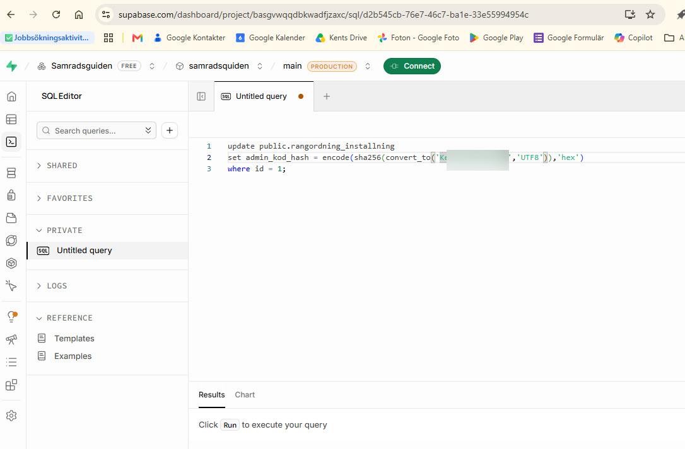

   *Bild 12. Kommandot som sätter adminkoden, i SQL Editor, före Run. Koden mellan citattecknen är maskerad. Fliken heter *Untitled query* och har en prick, vilket betyder osparade ändringar. Adressen slutar på ett eget id för just den här frågan (`sql/d2b545cb-…`). Källa: skärmdump, 2026-10-20.*

   *Obs:* även en maskerad kod kan avslöja början och ungefärlig längd. Visa därför aldrig koden i en bild som publiceras, och byt koden (kör kommandot igen med en ny) om en bild skulle ha visat för mycket.
4. **Använd den:** klicka på *nollställ* under gruppens rangordning, skriv koden och bekräfta. Vid fel kod väntar databasen två sekunder innan den svarar nej, för att göra gissning långsam.
   Så går det till på sidan: (1) du klickar på *nollställ*, (2) webbläsaren frågar efter **adminkoden** i en liten ruta, (3) du skriver koden och trycker OK, (4) webbläsaren frågar "Alla röster raderas för alla besökare. Det går inte att ångra. Fortsätta?" och du bekräftar, (5) databasen jämför koden. Är den rätt raderas alla röster och sidan visar att ingen har röstat. Är den fel visas "Fel kod" efter ungefär två sekunder, och inget raderas. Avbryter du i något steg händer ingenting. Du behöver alltså **bara skriva koden, inget annat lösenord**, och inte logga in i Supabase.
5. Har du inte satt någon kod går det inte att nollställa via sidan. Du kan alltid göra det direkt i SQL Editor: `truncate public.rangordning_roster;`.

*Varför kod?* Sidan är öppen och utan inloggning. En knapp som nollställer utan kontroll hade kunnat användas av vem som helst som hittar sidan.

### Steg 8. Flytta in i maxima.html (när prototypen är godkänd)

Tabell 6 på [maxima.html](https://kentlundgren.github.io/Codex/Fritid/NF/Samradsguiden/maxima.html#tabell-6) har idag ingen rangordning. För att flytta in funktionen behövs fyra ändringar: `data-id` och `data-titel` på tabellens rader, `<div id="rangordning"></div>` före tabellen, och tre rader i `<head>` (`rangordning/rangordning.css`, `rangordning/rangordning_config.js`, `rangordning/rangordning.js`, med relativ sökväg från maxima.html). Löptexten som hänvisar till "rad 1–4" avser kolumnen **Förslag** och ändras inte.

## 3b. Hitta tillbaka i Supabase och använda SQL Editor <a id="hitta-tillbaka"></a>

### Vägen tillbaka till projektet

Allt ligger bakom inloggningen (GitHub). Adresserna nedan fungerar bara när du är inloggad. Vägen går från det stora till det lilla: alla organisationer, en organisation, ett projekt, ett verktyg i projektet.

| Nivå | Adress | Vad du ser |
|---|---|---|
| 1. Alla organisationer | [supabase.com/dashboard/organizations](https://supabase.com/dashboard/organizations) | En lista över dina organisationer ("Your organizations"). Här börjar du om du är osäker. |
| 2. En organisation | [supabase.com/dashboard/org/vgxnypkoomlcwopoigwh](https://supabase.com/dashboard/org/vgxnypkoomlcwopoigwh) | Organisationen *Samradsguiden* och de projekt som ligger i den. Sista delen av adressen är organisationens id. |
| 3. Ett projekt | [supabase.com/dashboard/project/basgvwqqdbkwadfjzaxc](https://supabase.com/dashboard/project/basgvwqqdbkwadfjzaxc) | Projektet *samradsquiden*: status ("Healthy"), projektadress, region. Här finns vänstermenyn med alla verktyg. |
| 4. SQL Editor | [supabase.com/dashboard/project/basgvwqqdbkwadfjzaxc/sql/new](https://supabase.com/dashboard/project/basgvwqqdbkwadfjzaxc/sql/new) | En tom fråga där du skriver och kör SQL. |

Du kan hoppa direkt till nivå 3 eller 4 om du har adressen som bokmärke. Det är den korta vägen. Utan bokmärke går du via nivå 1, 2 och 3 och klickar på SQL Editor (ikonen `>_`) i vänstermenyn.

### Så läser du adressen

Adresserna följer ett mönster:

```
https://supabase.com/dashboard/project/<projektets id>/<verktyg>
                                       basgvwqqdbkwadfjzaxc  sql/new
```

- **Projektets id** (`basgvwqqdbkwadfjzaxc`) är samma sak som början på projektadressen: `https://basgvwqqdbkwadfjzaxc.supabase.co`. Det är alltså projektets namn i Supabases system, och det är det som skiljer ditt projekt från alla andra.
- **Verktyget** är det som står efter id:t. `sql/new` betyder SQL Editor med en **ny, tom fråga**. Andra verktyg har andra ändelser, och de nås enklast via vänstermenyn.
- **`sql/<långt id>`**, till exempel `sql/d2b545cb-…`, är en **redan öppnad fråga**. Varje gång du öppnar `sql/new` skapas en ny, och Supabase ger den ett eget id. Adressen i webbläsaren byter då ändelse.

### Hur SQL Editor fungerar

- **Vad det är.** Ett fönster där du skriver SQL-kommandon och kör dem direkt mot projektets databas. Du skriver, trycker **Run** (eller Ctrl+Enter) och ser resultatet under fönstret. Efter ett lyckat kommando som inte ger tillbaka rader står det *Success. No rows returned*.
- **Vem som får.** Bara du, som är inloggad som ägare. Du kör som ägare, och därför kan du göra saker som besökarna på sidan inte kan: skapa och ändra tabeller, läsa alla röster, sätta adminkoden, stänga röstningen.
- **Skriver man all SQL där?** Nej, och det är viktigt att skilja på två saker:
  1. **Besökarna** på sidan skriver ingen SQL. Sidans JavaScript anropar bara de fem funktionerna (`hamta_roster`, `hamta_status`, `spara_rost`, `radera_min_rost`, `nollstall_roster`). Det är funktionerna, som du skrev i SQL Editor en gång, som i sin tur rör tabellerna.
  2. **Du som ägare** använder SQL Editor för uppsättning och skötsel: skapa tabeller och funktioner (SQL-filen), sätta adminkoden, flytta sista dag, stänga eller öppna röstningen, ta bort en enstaka röst. Du kan också titta på rösterna utan SQL i **Table Editor**, som visar tabellerna som kalkylblad.
- **Vad som sparas.** SQL Editor sparar inte automatiskt (se Bild 7). Fliken *Untitled query* med en prick betyder osparade ändringar. Stänger du fliken försvinner texten, men kommandot du redan har kört gäller i databasen. Tryck **Save** (Ctrl+S) om du vill behålla en fråga. Kör inte ett kommando två gånger i onödan: `update`-kommandon som sätter koden går att upprepa, men `delete` och `truncate` raderar varje gång.
- **Adminkoden i SQL Editor.** Texten du skriver, inklusive koden i `convert_to('…')`, syns i fönstret och kan hamna i historiken. Radera texten ur fönstret när du har kört kommandot, och använd inte en kod som liknar ditt namn.
- **Andra sätt.** SQL kan också köras utanför webbläsaren, med databaslösenordet och ett verktyg som `psql` eller Supabase CLI. Det behövs inte här. SQL Editor räcker.

## 4. Så hänger sidans kod ihop <a id="kod"></a>

```
Maxima/rangordning.html   Sidan för MAXIMA: Tabell 6 i HTML, utan databas fungerar den som vanlig tabell
rangordning/index.html             Allmänt om rangordningar i Samrådsguiden, med länk till pågående omröstningar
rangordning/rangordning.js         Dra och släpp, pilknappar, medelplats, markeringar, spara och hämta
rangordning/rangordning.css        Utseende
rangordning/rangordning_config.js  Projektets adress och publika nyckel
supabase_setup.sql                 Tabeller, regler och de fem funktionerna
```

- **Utan JavaScript eller databas** visar sidan Tabell 6 i förslagets ordning. Det motsvarar `BASE_DATA` som reserv i Firebase-lösningen.
- **Sidan pratar direkt med Supabase** via ett vanligt webbanrop (`fetch`) till databasens API. Inget bibliotek behövs.
- **Sidan hämtar rösterna var 15:e sekund** och efter varje sparning. Direktuppdatering utan omladdning (Supabase Realtime) valdes bort, eftersom den kräver att tabellen går att läsa direkt, vilket vore sämre för nycklarnas skydd.
- **Namn visas som ren text** (inte som HTML), så att ingen kan klistra in kod i namnfältet.

## 5. Jämförelse med Firebase <a id="jamforelse"></a>

Firebase-sidan, [databas.html](https://kentlundgren.github.io/foreningar/BjerredsSaltsjobad/inpasseringar/databas.html), beskriver inpasseringsstatistiken för Bjerreds Saltsjöbad. Där ligger siffrorna i Firebase Realtime Database, medlemmar loggar in och uppdaterar dem, och nya användare bjuds in av en administratör. Här är det en rangordning som alla får ändra utan inloggning. Skillnaderna i uppgift påverkar jämförelsen, så den nedan gäller främst vad som krävs för **den här** uppgiften.

| | **Firebase** (som i databas.html) | **Supabase** (den här rangordningen) |
|---|---|---|
| Datamodell | Realtime Database: ett stort JSON-träd, `data/2026/Medlemmar – armband/3 = 90`. Firestore (samlingar och dokument) finns också och används av Bjerred-skylt. | PostgreSQL: vanliga tabeller med rader och kolumner. |
| Hur data beskrivs | Träd i konsolen och regler i JSON | SQL-fil som körs en gång |
| Vem får skriva | Inloggade användare, inbjudna med namn, e-post och tillfälligt lösenord | Ingen inloggning. Skyddet ligger i funktionerna och i en nyckel per webbläsare. |
| Regler | Firebase Security Rules (eget regelspråk) | Row Level Security och funktionsbehörigheter i SQL |
| Direktuppdatering | Inbyggd och enkel i Realtime Database | Finns (Realtime), men används inte här av säkerhetsskäl. Sidan hämtar om var 15:e sekund. |
| Projekt | Det befintliga projektet `skylt` (`skylt-e0c45`) återanvändes för flera sidor | Ett eget projekt för Samrådsguiden, så att öppna regler inte påverkar andra sidors data |
| Reserv om databasen är nere | `BASE_DATA` ligger kvar i koden | Tabell 6 visar förslaget utan databas |
| Inbyggd inloggning | Ja, och används där | Finns, men används inte här |
| Gratisnivå | Finns | Finns. Enligt min kännedom pausas gratisprojekt efter en veckas inaktivitet och väcks med ett klick. Kontrollera mot Supabase. |
| Din insats i det här fallet | Konfigurera projekt, aktivera databas, skriva regler, bjuda in användare | Skapa konto och projekt, klistra in en SQL-fil, skicka två värden |

**Slutsats för den här uppgiften.** Det som tog tid i Firebase-lösningen var att hantera användare, inbjudningar och behörigheter. Här behövs inget av det. Då väger det tyngst att Supabase låter all databasuppsättning ligga i en enda SQL-fil som går att läsa, granska, spara i repot och köra om, medan Firebase-reglerna sätts i konsolen. För inloggade användare, direktuppdatering mellan många enheter eller en sida som redan ligger i ett Firebase-projekt är Firebase fortfarande ett rimligt val.

## 6. Säkerhet och integritet <a id="sakerhet"></a>

- **Öppen sida.** Vem som helst som hittar sidan kan rösta. Skyddet är att sidan inte länkas från menyn, att en webbläsare bara kan ha en röst åt gången, att funktionen avvisar felaktig indata och att antalet röster har ett tak (500). Det är ingen skyddad omröstning, och det är medvetet.
- **Rösta flera gånger.** Den som öppnar en privat flik eller rensar webbläsardata får en ny röst. Gruppens ordning är därför ett underlag för samtal och inte ett beslut.
- **En röst per webbläsare.** Nyckeln sparas i den webbläsare där man röstar, inte per dator eller person. Byter man namn eller flyttar om raderna ändras den befintliga rösten, det blir ingen ny. Två personer som använder samma webbläsare på samma dator delar därför en röst, och den som sparar sist skriver över den andra. Med en annan webbläsare, en annan webbläsarprofil eller en annan enhet blir det en ny röst. Detta är medvetet: utan inloggning finns inget annat sätt att veta vem som röstar. Se även [Möjliga utvidgningar](#utvidgningar).
- **Namn är personuppgifter.** Ett namn som någon skriver in visas öppet för alla besökare och lagras hos Supabase. Sidan säger det vid fältet. Rösten kan tas bort med knappen på sidan, och du kan radera enstaka rader i databasen (steg 6).
- **Publik nyckel.** Den ligger i `rangordning/rangordning_config.js` och syns för alla. Det är avsett. Den hemliga nyckeln ska aldrig läggas i en fil i repot.
- **Rösterna är publika på sidan.** Gruppens ordning syns för alla före sista dag, även för motparten i målet. Stäng röstningen med ett kommando (steg 6) om du vill frysa den.
- **Provat mot det riktiga projektet 2026-10-20.** SQL-skriptet kördes utan fel. Därefter provades fjorton anrop mot projektet (se steg 5): en giltig röst sparades och lästes, dubbletter och ogiltiga id nekades, direkt läsning, skrivning och ändring av tabellerna nekades, och teströsten raderades. Sidan provades också mot projektet i en webbläsare. Allt gick som avsett. Det som inte är provat är många samtidiga besökare och flera olika enheter.

## 6b. Möjliga utvidgningar (inte gjorda) <a id="utvidgningar"></a>

Prototypen är medvetet enkel. Följande går att lägga till om behovet uppstår. Inget av det är byggt, och sidan [rangordning.html](https://kentlundgren.github.io/Codex/Fritid/NF/Samradsguiden/Maxima/rangordning.html) är oförändrad.

| Utvidgning | Vad det löser | Hur det kan göras | Baksida |
|---|---|---|---|
| **Knapp för delad dator**, till exempel "Någon annan röstar på den här datorn" | Två personer kan dela dator och webbläsare utan att skriva över varandras röst. | Sidan skapar en ny slumpad nyckel i webbläsaren och nollställer den lokala röstmarkeringen. Den tidigare rösten ligger kvar i databasen. Ingen ändring i databasen behövs. | Gör det lättare att rösta flera gånger, men det går redan med en annan webbläsare. |
| **Hindra dubbla röster från samma webbläsare efter rensning** | Den som rensar webbläsardata får inte en andra röst. | Kräver att man vet vem som röstar, till exempel inloggning eller en kod per person. | Bryter mot kravet på ingen inloggning. Troligen onödigt för en liten grupp. |
| **Personlig kod eller länk per kollega** | Exakt en röst per person. | Varje kollega får en hemlig länk eller kod, och databasen godkänner bara kända koder. | Mer administration. Passar om gruppen är liten och känd. |
| **Visa varje persons ordning** | Att se hur var och en rangordnat, och inte bara medelvärdet. | Databasen lagrar redan varje röst, och `hamta_roster()` ger dem. Sidan behöver bara visa dem. | Påverkar integriteten. Namnen är frivilliga, och anonyma röster skulle också synas som enskilda listor. |
| **Flera omröstningar** (till exempel om andra samråd) | Samma databas kan rymma rangordningar om fler ämnen. | Lägg till kolumnen `omrostning` (text) i `rangordning_roster`, låt funktionerna ta ett omröstnings-id och låt varje sida skicka med sitt eget. Gemensam kod finns redan i `rangordning/`, och varje omröstning är en sida i en undermapp, som `Maxima/`. | Kräver ändring av SQL-filen och en omkörning. Befintliga röster får då värdet för MAXIMA. |
| **Direktuppdatering** | Rösterna syns direkt utan att vänta på de 15 sekunderna. | Supabase Realtime. Kräver att tabellen går att läsa av besökare, vilket i dag inte är fallet. | Sämre skydd för nycklarna. Avvaktade därför. |

## 6c. Checklista för databasen <a id="checklista"></a>

Det här är vad som bör göras eller hållas koll på medan röstningen pågår.

| När | Vad | Varför |
|---|---|---|
| **Före start** | **Nollställ** (steg 7, eller `truncate public.rangordning_roster;`) så att provrösterna försvinner. | Teströster från provning blir annars med i gruppens ordning. |
| **Före start** | Sätt adminkoden (steg 7) och spara den i en lösenordshanterare. | Annars går det inte att nollställa via sidan. |
| **Före start** | Kör Supabases säkerhetskontroll: i projektet, **Advisors** (eller **Security Advisor**) i menyn. Den listar bland annat tabeller utan Row Level Security. Menynamnet kan skilja sig. | Bekräftar att inget oavsiktligt är öppet. Tabellerna ska vara låsta, och SQL-filen gör det. |
| **Under** | Titta vid behov i **Table Editor** på `rangordning_roster` (du ser den som ägare). | Se att röster kommer in och att namnen är rimliga. |
| **Under** | Ta bort en enstaka olämplig röst: `delete from public.rangordning_roster where namn = '…';` | Sidan är öppen, så namnfältet kan fyllas med vad som helst. |
| **Sista dag** | Röstningen stänger sig själv 2026-11-06 23:59:59 svensk tid. Flytta dagen eller stäng tidigare med kommandona i steg 6. | Ordningen blir slutlig. |
| **Efter sista dag** | **Exportera rösterna**: Table Editor, tabellen `rangordning_roster`, exportera som CSV, eller spara resultatet (gruppens ordning) som text eller skärmdump. Lägg inte filen med namn i det publika repot. | Gratisprojekt har enligt projektets översikt (Bild 5) inga säkerhetskopior ("No backups"). Gör därför en egen kopia. Före en nollställning gäller samma sak. |
| **Efter** | Radera projektet när det inte behövs, eller låt det vara. Gratisprojekt kan pausas efter längre inaktivitet. Kontrollera villkoren hos Supabase. | Rösterna ligger öppet i molnet så länge projektet finns. Namn är personuppgifter. |
| **Vid behov** | Byt projektnamnet `samradsquiden` till `samradsguiden` (Project Settings, General). | Bara en etikett. |
| **Om fler omröstningar** | Lägg till kolumnen `omrostning` enligt [Möjliga utvidgningar](#utvidgningar). | Databasen rymmer idag en omröstning. |
| **Alltid** | Lägg aldrig hemliga nycklar (`service_role`, `secret`) eller adminkoden i filer i repot eller i chatten. | Den publika nyckeln i konfigurationen är avsedd att vara öppen, men inget annat. |

## 7. Korsreferens åt andra hållet <a id="korsreferens"></a>

Firebase-beskrivningen ligger i ett annat repo (`foreningar`), som inte ändras härifrån. Lägg till följande stycke i [databas.html](https://kentlundgren.github.io/foreningar/BjerredsSaltsjobad/inpasseringar/databas.html), till exempel efter avsnittet om Firebase-projekt och konfiguration:

```html
<h2 id="jamfor-supabase">Jämförelse med Supabase</h2>
<p>Samma uppgift, att låta många läsare uppdatera en gemensam sida, har också lösts med Supabase i Samrådsguiden (rangordning av frågor, utan inloggning). Beskrivningen finns i
<a href="https://github.com/kentlundgren/Codex/blob/main/Fritid/NF/Samradsguiden/supabase.md">supabase.md</a>,
med en <a href="https://github.com/kentlundgren/Codex/blob/main/Fritid/NF/Samradsguiden/supabase.md#jamforelse">jämförelse mellan Firebase och Supabase</a>.</p>
```

## 8. Källor

- Supabase (u.å.) *Row Level Security*. Tillgänglig på: <https://supabase.com/docs/guides/database/postgres/row-level-security> (Hämtad: 20 oktober 2026). *(Förklarar hur tabeller låses och öppnas med regler.)*
- Supabase (u.å.) *Database Functions*. Tillgänglig på: <https://supabase.com/docs/guides/database/functions> (Hämtad: 20 oktober 2026). *(Förklarar funktioner i databasen som sidan kan anropa.)*
- Supabase (u.å.) *Understanding API keys*. Tillgänglig på: <https://supabase.com/docs/guides/api/api-keys> (Hämtad: 20 oktober 2026). *(Förklarar skillnaden mellan publik och hemlig nyckel.)*
- Supabase (u.å.) *REST API*. Tillgänglig på: <https://supabase.com/docs/guides/api> (Hämtad: 20 oktober 2026). *(Förklarar hur en webbsida anropar databasen över internet.)*
- Lundgren, K. (2026) *Firebase-integration – Bjerreds Saltsjöbad*. Tillgänglig på: <https://kentlundgren.github.io/foreningar/BjerredsSaltsjobad/inpasseringar/databas.html> (Hämtad: 20 oktober 2026). *(Primärkälla för jämförelsen: Kents egen beskrivning av Firebase-lösningen.)*
